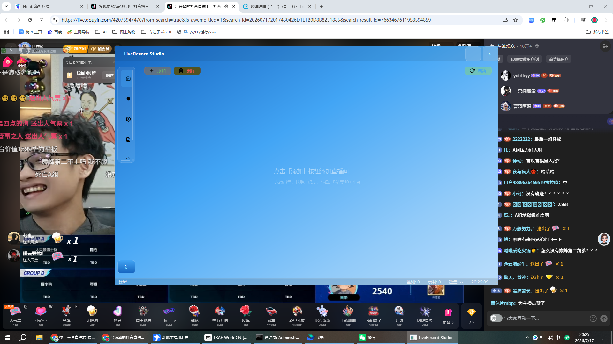
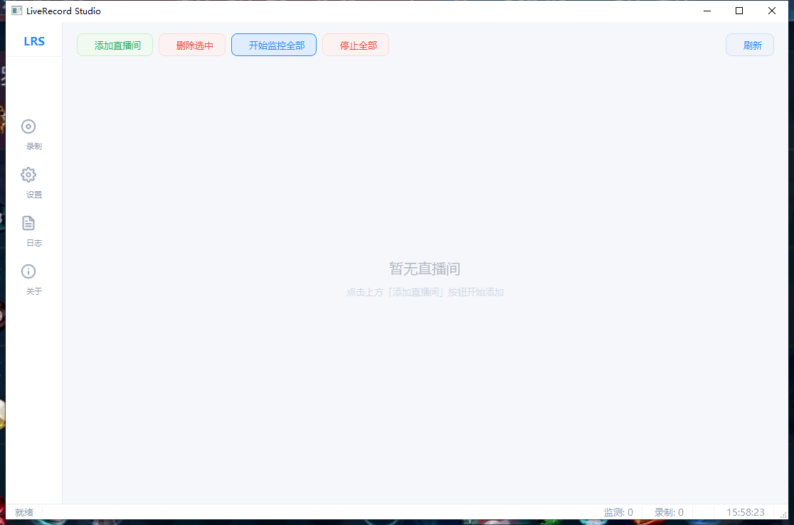
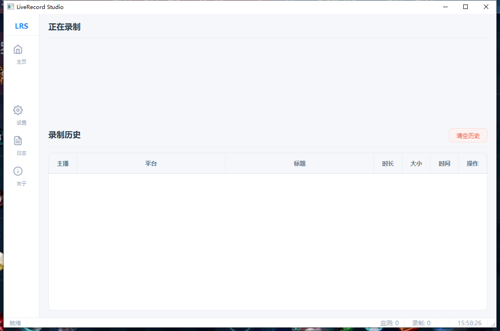
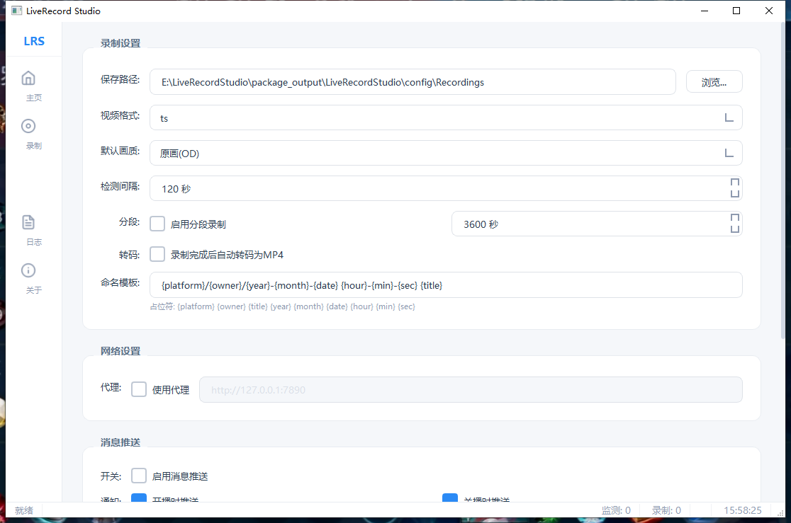
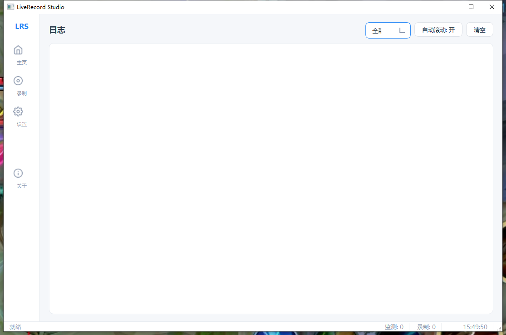

# LiveRecordStudio

**English** | [中文](README.md)

**LiveRecordStudio** is a Python-based multi-platform live stream recorder. It monitors whether a streamer has gone live on Douyin, Bilibili, Huya, Douyu, Kuaishou, TikTok, YouTube and other major platforms, then records the stream automatically through a PySide6 / Qt desktop interface.



## ✨ Features

- **Multi-platform support**: Douyin (抖音), Bilibili (哔哩哔哩), Huya (虎牙), Douyu (斗鱼), Kuaishou (快手), Xiaohongshu (小红书), TikTok, Twitch, YouTube, YY Live, Bigo
- **Live monitoring**: Background polling of room status — recording starts when the streamer goes live and stops when the stream ends
- **Recording core**: Resolves stream URLs with `streamget` and records via `ffmpeg`; supports TS / MKV / FLV / MP4 output
- **Quality selection**: Original (OD) / Ultra HD (UHD) / HD / SD / Low (LD)
- **Flexible file management**: Custom filename templates (`{platform}`, `{owner}`, `{title}`, `{year}`, …), scheduled segmentation, optional automatic MP4 conversion after recording (with optional H.264 re-encode)
- **Recording history**: Local history with duration and size statistics, plus one-click "open containing folder"
- **Built-in log viewer**: A dedicated log tab powered by loguru
- **Proxy support**: HTTP/SOCKS proxy configurable per platform
- **Event push (Webhook)**: Send stream-start / stream-end events to a custom webhook URL
- **Packaging friendly**: Bundled PyInstaller configurations (`LiveRecordStudio.spec`, `launcher.spec`) to build a portable Windows executable

## 📸 Screenshots

| Live monitoring | Recordings |
| --- | --- |
|  |  |

| Settings | Logs |
| --- | --- |
|  |  |

## 🛠️ Tech stack

- Python 3.11
- [PySide6](https://doc.qt.io/qtforpython/) — Qt GUI
- [streamget](https://github.com/ihmily/streamget) — multi-platform live stream URL resolver (MIT License)
- [FFmpeg](https://ffmpeg.org/) — stream capture and format conversion
- [loguru](https://github.com/Delgan/loguru) — logging
- PyInstaller — packaging

## 📦 Installation

### 1. Requirements

- Windows 10/11 (other platforms may work but are not fully tested)
- Python 3.10+
- FFmpeg (either on `PATH` or placed at `ffmpeg/bin/ffmpeg.exe` in the project root)

### 2. Install dependencies

```bash
pip install -r requirements.txt
```

### 3. Prepare FFmpeg

The application looks for `ffmpeg` in the following order:

1. `ffmpeg/bin/ffmpeg.exe` next to the executable (packaged build)
2. `ffmpeg/bin/ffmpeg.exe` in the project root (development)
3. `ffmpeg` on the system `PATH`
4. Common install locations such as `%PROGRAMFILES%\FFmpeg`

You can download a Windows build from [ffmpeg.org](https://ffmpeg.org/download.html) or [gyan.dev](https://www.gyan.dev/ffmpeg/builds/), then extract it into `ffmpeg/bin/`.

### 4. Run

```bash
python main.py        # run from a console
python main.pyw       # double-click on Windows (no console window)
```

> Note: resolving Douyin streams requires a Node.js runtime. Run `streamget install-node` to install it.

## 📦 Packaging (optional)

Build a portable executable with PyInstaller:

```bash
pip install pyinstaller
pyinstaller LiveRecordStudio.spec          # main application
pyinstaller launcher.spec                  # optional double-click launcher
```

Build output goes to `dist/`. Copy `ffmpeg/bin/ffmpeg.exe` to `dist/LiveRecordStudio/_internal/ffmpeg/bin/` so FFmpeg ships with the build.

## 📖 Project structure

```
LiveRecordStudio/
├── app/
│   ├── core/                  # Core logic
│   │   ├── stream_parser.py   # Multi-platform stream resolution (wraps streamget)
│   │   ├── monitor.py         # Live-status polling
│   │   ├── recorder.py        # QProcess + ffmpeg recording
│   │   └── task_manager.py    # Global task scheduling
│   ├── ui/                    # 5 tabs (Live / Recordings / History / Logs / Settings)
│   ├── config/                # Configuration handling
│   ├── models/                # Data models
│   ├── utils/                 # ffmpeg lookup, filename templates, history manager
│   └── style.qss              # Stylesheet
├── resources/icons/           # Icons
├── tests/                     # Tests
├── main.py / main.pyw         # Entry points
├── launcher.py                # Double-click launcher
└── requirements.txt           # Dependencies
```

## 📄 License and third-party dependencies

Released under the [MIT License](LICENSE).

| Dependency | License | Source |
| --- | --- | --- |
| [streamget](https://pypi.org/project/streamget/) | MIT | PyPI / [GitHub](https://github.com/ihmily/streamget) |
| PySide6 | LGPL-3.0 / commercial dual license | Qt |
| loguru | MIT | PyPI |
| FFmpeg | LGPL-2.1 / GPL (depends on build) | [ffmpeg.org](https://ffmpeg.org/) |

## ⚠️ Disclaimer

This tool is intended for personal study and research only. Please comply with the terms of service of each live streaming platform. Copyright of recorded content belongs to the original author; do not redistribute it commercially or without authorization.

## 🤝 Contributing

Issues and pull requests are welcome — see [CONTRIBUTING.md](CONTRIBUTING.md).
