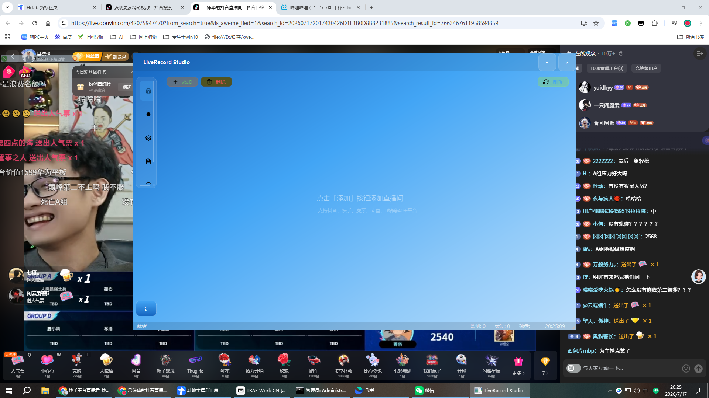
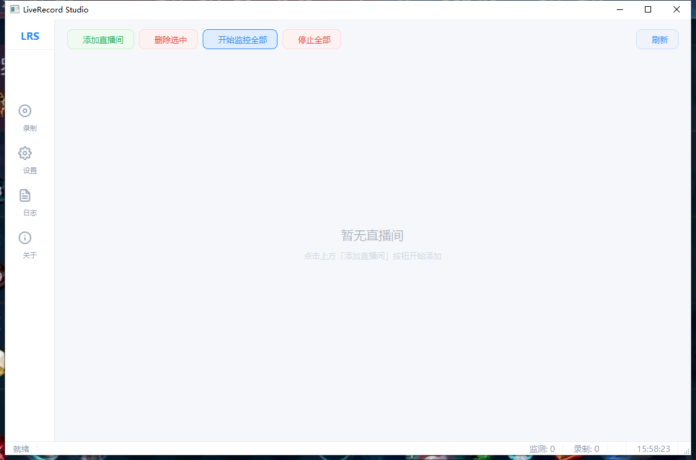
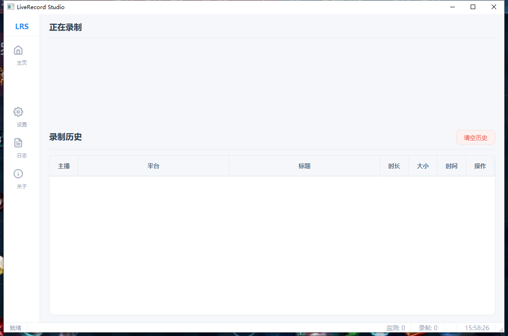
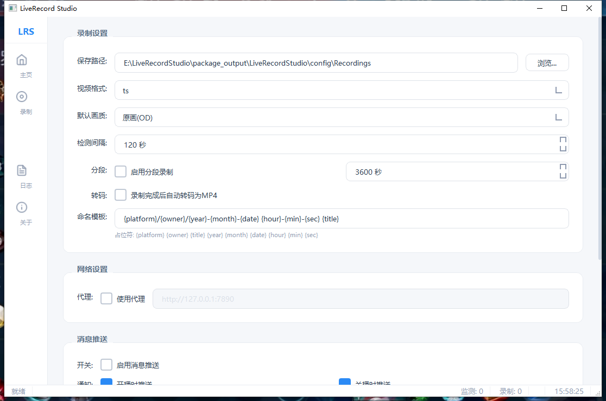
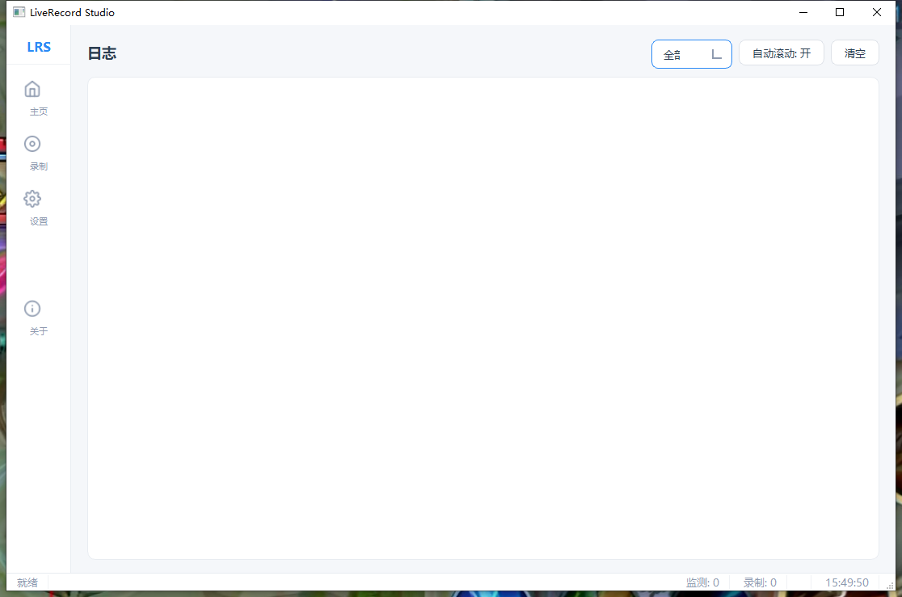

# LiveRecordStudio

**LiveRecordStudio** 是一款基于 Python 的多平台直播录制工具，支持对抖音、B 站、虎牙、斗鱼、快手、TikTok、YouTube 等主流直播平台进行开播监控与自动录制，并提供图形化界面（PySide6 / Qt）方便日常使用。



## ✨ 功能特性

- **多平台支持**：抖音、哔哩哔哩、虎牙、斗鱼、快手、小红书、TikTok、Twitch、YouTube、YY直播、Bigo
- **开播监控**：后台轮询检测直播间状态，开播自动开始录制、下播自动停止
- **录制核心**：基于 `streamget` 解析直播流地址 + `ffmpeg` 拉流录制，支持 TS / MKV / FLV / MP4 格式
- **画质选择**：原画（OD）/ 超清（UHD）/ 高清（HD）/ 标清（SD）/ 流畅（LD）
- **灵活的文件管理**：自定义文件名模板（`{platform}` `{owner}` `{title}` `{year}` 等占位符）、定时自动分片、录制完成后自动转 MP4（可选 H.264 重编码）
- **录制历史**：本地历史记录、时长/大小统计、一键打开文件所在位置
- **日志查看**：内置日志标签页，基于 loguru 记录运行日志
- **网络代理**：支持为指定平台配置 HTTP/SOCKS 代理
- **事件推送**（Webhook）：开播 / 下播事件可推送到自定义 Webhook 地址
- **打包友好**：内置 PyInstaller 配置（`LiveRecordStudio.spec`、`launcher.spec`），可打包为免安装的 Windows 程序

## 📸 截图

| 直播监控 | 录制管理 |
| --- | --- |
|  |  |

| 设置 | 日志 |
| --- | --- |
|  |  |

## 🛠️ 技术栈

- Python 3.11
- [PySide6](https://doc.qt.io/qtforpython/)（Qt 图形界面）
- [streamget](https://github.com/ihmily/streamget)（多平台直播流解析，MIT License）
- [FFmpeg](https://ffmpeg.org/)（拉流录制 / 格式转换）
- [loguru](https://github.com/Delgan/loguru)（日志）
- PyInstaller（打包）

## 📦 安装运行

### 1. 环境要求

- Windows 10/11（其他平台理论上可运行，未充分测试）
- Python 3.10+
- FFmpeg（加入 PATH 或放到项目 `ffmpeg/bin/ffmpeg.exe`）

### 2. 安装依赖

```bash
pip install -r requirements.txt
```

### 3. 准备 FFmpeg

程序按以下顺序查找 ffmpeg：

1. 打包环境下 exe 同级的 `ffmpeg/bin/ffmpeg.exe`
2. 项目根目录 `ffmpeg/bin/ffmpeg.exe`
3. 系统 `PATH` 中的 `ffmpeg`
4. 常见安装位置（`%PROGRAMFILES%\FFmpeg` 等）

可从 [ffmpeg 官网](https://ffmpeg.org/download.html) 或 [gyan.dev 构建版](https://www.gyan.dev/ffmpeg/builds/) 下载 Windows 版本，解压后放到 `ffmpeg/bin/` 下即可。

### 4. 运行

```bash
python main.py        # 命令行运行
python main.pyw       # Windows 下双击启动（无控制台窗口）
```

> 提示：抖音平台解析需要 Node.js 运行时，可执行 `streamget install-node` 安装。

## 📦 打包（可选）

使用 PyInstaller 打包为免安装程序：

```bash
pip install pyinstaller
pyinstaller LiveRecordStudio.spec          # 主程序
pyinstaller launcher.spec                  # 双击启动器（可选）
```

打包完成后产物在 `dist/` 目录，将 `ffmpeg/bin/ffmpeg.exe` 复制到 `dist/LiveRecordStudio/_internal/ffmpeg/bin/` 即可随包分发。

## 📖 项目结构

```
LiveRecordStudio/
├── app/
│   ├── core/            # 核心逻辑
│   │   ├── stream_parser.py   # 多平台直播流解析（封装 streamget）
│   │   ├── monitor.py         # 开播状态轮询监控
│   │   ├── recorder.py        # QProcess + ffmpeg 录制
│   │   └── task_manager.py    # 全局任务调度
│   ├── ui/              # 5 个标签页（直播/录制/历史/日志/设置）
│   ├── config/          # 配置管理
│   ├── models/          # 数据模型
│   ├── utils/           # 工具（ffmpeg 查找、文件命名、历史管理等）
│   └── style.qss        # 界面样式
├── resources/icons/     # 图标资源
├── tests/               # 测试
├── main.py / main.pyw   # 入口
├── launcher.py          # 双击启动器
└── requirements.txt     # 依赖
```

## 📄 开源许可与依赖

本项目基于 [MIT License](LICENSE) 开源。

主要第三方依赖：

| 依赖 | 许可证 | 来源 |
| --- | --- | --- |
| [streamget](https://pypi.org/project/streamget/) | MIT | PyPI / [GitHub](https://github.com/ihmily/streamget) |
| PySide6 | LGPL-3.0 / 商业双许可 | Qt 官方 |
| loguru | MIT | PyPI |
| FFmpeg | LGPL-2.1 / GPL（视构建配置） | [ffmpeg.org](https://ffmpeg.org/) |

## ⚠️ 免责声明

本工具仅供个人学习与研究使用，请遵守各直播平台的服务条款，录制内容的版权归原作者所有，请勿用于商业用途或未经授权的传播。

## 🤝 参与贡献

欢迎提交 Issue 和 Pull Request，详见 [CONTRIBUTING.md](CONTRIBUTING.md)。
